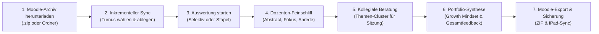

# LTB-Auswerter · FSU Jena (ZLB)
### Intelligente Reflexions- & Feedback-Plattform für das Seminar *„Reflexion schulischer Praxis“ (RSP)*
**Friedrich-Schiller-Universität Jena · Zentrum für Lehrerbildung und Bildungsforschung (ZLB)**  
*Dozent: Tim · Entwickelt für die universitäre Praxisbegleitung im Lehramtsstudium*

---

## 🌟 Über die Plattform

Der **LTB-Auswerter** ist eine spezialisierte, datenschutzkonforme Lehr- und Auswertungs-Plattform für Dozierende an der Friedrich-Schiller-Universität Jena. Sie unterstützt dich dabei, die wöchentlichen oder turnusmäßigen Lerntagebücher (LTB 1 bis 6) deiner Lehramtsstudierenden zeitsparend, mit hohem didaktischen Tiefgang und in einem authentischen, wertschätzenden Dozenten-Stil auszuwerten.

Die App läuft vollständig **lokal im Browser** (Offline-First via IndexedDB) und benötigt keine Server-Datenbank. Alle Daten deiner Studierenden verbleiben zu 100 % auf deinem Gerät (DSGVO-konform).

---

## 🚀 Der typische Dozierenden-Workflow (Schritt für Schritt)

Hier erfährst du, wie du die Plattform optimal in deinem Seminaralltag einsetzt – von der Moodle-Abgabe bis zum Semesterabschluss.

---

### Schritt 1: Vorbereitung & Semester wählen
1. Öffne die Plattform im Browser (auf deinem Mac oder iPad).
2. Oben im Header siehst du den **Semester-Wähler** (z. B. `🎓 WS 26/27`).
3. Wenn ein neues Semester beginnt, klicke auf das Semester-Menü und wähle **„+ Neues Semester anlegen...“**. Das System schlägt dir automatisch das nächste Semester vor (z. B. auf `WS 26/27` folgt `SS 27`, darauf `WS 27/28`).
4. **API-Status prüfen**: Rechts neben dem Semesterwähler zeigt dir der Punkt `🟢 Gemini API` an, dass die Verbindung einsatzbereit ist. (Ein kostenloser Schulschlüssel ist bereits vorinstalliert; du kannst in den Einstellungen jederzeit deinen eigenen Schlüssel hinterlegen).

---

### Schritt 2: Lerntagebücher aus Moodle einlesen
1. Lade in deinem Moodle-Kurs das Sammelarchiv der Einreichungen herunter.
   * **Auf dem Mac**: Safari entpackt ZIP-Dateien oft automatisch in einen Ordner. Beide Formate (die `.zip`-Datei oder der ganze entpackte Ordner) werden unterstützt!
   * **Auf dem iPad**: Ziehe die heruntergeladene `.zip`-Datei einfach per Drag & Drop in das Upload-Feld.
2. Wähle den passenden Turnus (z. B. **LTB 1**) und ziehe die Datei in das Upload-Feld.
3. **Automatischer Roster-Sync**: Die Plattform liest alle Namen und Matrikelnummern aus der Moodle-Struktur aus und legt automatisch das Teilnehmerverzeichnis deines Seminars an.
4. **Inkrementeller Modus**: Du kannst Lerntagebücher von Früh-Abgebern schon Tage vor der Deadline auswerten! Wenn du später eine aktualisierte Moodle-ZIP hochlädst, erkennt die App automatisch:
   * Neue Nachzügler werden ergänzt.
   * Deine bereits formulierten und freigegebenen Feedbacks bleiben **vollständig geschützt** und werden nicht überschrieben!

---

### Schritt 3: Feedback mit der Anti-KI-Engine generieren
1. Klicke bei einem einzelnen Studierenden auf **„Auswerten“** oder nutze die **Stapelverarbeitung**:
   * Du kannst über die Kontrollkästchen gezielt bestimmte Studierende ankreuzen (z. B. nur die 5 neuen Einreichungen).
   * Bereits bewertete Studierende sind standardmäßig ausgegraut, sodass du keine doppelten Anfragen sendest.
2. **Sichere Free-Tier Queue**: Beim Stapellauf pausiert die App automatisch 4,5 Sekunden zwischen den Abfragen (max. 13 Anfragen pro Minute), um API-Fehler zuverlässig zu verhindern.
3. **Die Anti-KI-Engine**:
   * **Strikte 10-Sätze-Begrenzung**: Das Dozenten-Feedback bleibt prägnant, lesbar und überschreitet niemals 10 Sätze.
   * **Echter Dozenten-Stil (Tim)**: Keine generischen KI-Floskeln (*„Es ist beachtlich...“*, *„Du legst ein solides Fundament...“* sind auf einer internen Blacklist gesperrt).
   * **Konkrete Textbezüge**: Mindestens 2 bis 3 konkrete Situationen, Fachinhalte oder Zitate aus dem Lerntagebuch werden direkt im Feedback verarbeitet.
   * **Signatur**: Jedes Feedback schließt zuverlässig mit *„Viele Grüße sendet Dir Tim“*.

---

### Schritt 4: KI-Abstract & Didaktische Fokus-Empfehlung
Über jedem Dozenten-Feedback findest du eine Infokarte im FSU-Design:
1. **KI-Abstract**: Eine 2–3-sätzige Zusammenfassung der Praxiserfahrungen des Studierenden als schnelle Orientierungshilfe für dich.
2. **Empfohlener didaktischer Fokus**: Die KI schlägt dir begründet vor, aus welchem der **6 didaktischen Blickwinkel** das Feedback formuliert werden sollte:
   * *Unterrichtsdynamik & Schülerverhalten*
   * *Rollenwechsel & Lehrkraft-Selbstverständnis*
   * *Theorie-Praxis-Transfer & Fachdidaktik*
   * *Klassenführung & Beziehungsarbeit*
   * *Umgang mit Belastung & Selbstfürsorge*
   * *Differenzierung & Heterogenität*
3. Mit einem Klick auf **„Fokus übernehmen“** kannst du den Vorschlag aktivieren oder jederzeit frei einen anderen Blickwinkel wählen und das Feedback mit *„Mit neuem Fokus generieren“* neu ausrichten.

---

### Schritt 5: Intelligente Namens- & Anrede-Engine
* **Immer Vorname**: Die Ansprache lautet ausnahmslos **„Lieber [Vorname],“** bzw. **„Liebe [Vorname],“** (z. B. *Lieber Fabian,* oder *Liebe Alexandra,*).
* Das System filtert Nachnamen (z. B. *Kaulfuß*) und unsichere Floskeln (*„Liebe/r“*, *„Hallo,“*) vollständig heraus.
* **Manueller Gender-Toggle (`♂`/`♀`)**:
  * Falls ein Vorname ungewöhnlich oder uneindeutig ist, kannst du mit einem Klick auf das Anrede-Badge (in der Workbench oder im Semester-Portfolio) das Geschlecht umstellen.
  * Bereits erstellte Feedbacks passen ihre Begrüßungszeile **sofort live** an, ohne dass deine manuellen Textanpassungen verloren gehen.

---

### Schritt 6: Kollegiale Beratungsrunde im Seminar
1. Klicke im Menü auf den Reiter **„Beratungsrunde“**.
2. Die Plattform bündelt alle in den Lerntagebüchern geschilderten Herausforderungen automatisch in thematische Cluster:
   * *Unterrichtsstörungen & Disziplin*
   * *Raumpräsenz & Körpersprache*
   * *Deeskalation & Beziehungsarbeit*
   * *Differenzierung & Lerntempo*
   * *Rollenwechsel & Autorität*
3. Jedem Cluster sind die konkreten Fallbeispiele der Studierenden zugeordnet.
4. **1-Klick-Agenda**: Mit dem Button **„Sitzungs-Agenda kopieren“** erhältst du einen strukturierten Ablaufplan für deine kollegiale Fallberatung in der nächsten Seminarsitzung.

---

### Schritt 7: Semester-Portfolio & Längsschnitt-Reflexion
1. Klicke auf den Reiter **„Semester-Portfolio“**.
2. Hier siehst du die chronologische Entwicklung jedes Studierenden über alle 6 Lerntagebücher hinweg.
3. Klicke auf **„Semester-Gesamtfeedback erstellen“**:
   * Die KI liest alle 6 bisherigen Rückmeldungen und erstellt eine tiefgründige Gesamtsynthese in genau 3 Absätzen.
   * **Didaktischer Fokus**: Rollenentwicklung, **Growth Mindset** (Kompetenz wächst durch Reflexion) und **positive Fehlerkultur** (wie Pannen als Lernchancen genutzt wurden), gekoppelt mit ehrlich formuliertem Dozenten-Stolz.

---

### Schritt 8: Rückgabe an die Studierenden (Moodle)
* **Einzeln**: Klicke in der Workbench auf **„Feedback kopieren“** und füge es mit `Cmd+V` direkt in Moodle ein.
* **Im Sammel-Export**: Klicke im Header auf **„Moodle-Export“**. Die Plattform generiert ein ZIP-Archiv mit der exakten Moodle-Ordnerstruktur und legt für jeden Studierenden eine saubere Feedback-Datei (`Feedback_Dozent_Tim.txt`) ab.

---

### Schritt 9: Datensicherung & Gerätewechsel (iMac ↔ iPad)
Da alle Daten lokal im Browser gespeichert werden:
1. **Sicherung vor dem Schließen**: Klicke im Header auf **„Sicherung & Gerätewechsel“** und lade die Datei `RSP_LTB_Gesamtsicherung.json` herunter.
2. **Schutz vor Datenverlust**:
   * Wenn du ungesicherte Änderungen hast und mit der Maus den oberen Rand verlässt, erinnert dich ein Schließen-Modal an den Download.
   * Ein versehentliches Schließen des Tabs (`Cmd+W`) wird durch den Browser-Sicherheitsdialog verhindert.
3. **Gerätewechsel (z. B. iMac zu iPad)**:
   * Lade die `.json`-Datei auf dem iMac herunter.
   * Sende sie per **AirDrop** oder über **iCloud Drive** an dein iPad.
   * Öffne die App auf dem iPad, klicke im Menü auf **„Backup wiederherstellen“** und wähle die Datei aus. Alle Semester, Studierenden und Feedbacks sind sofort 1:1 vorhanden!

---

## 📋 Tastatur-Shortcuts für schnelles Arbeiten

| Taste | Aktion |
|---|---|
| `Pfeiltaste links (←)` | Zur vorherigen Einreichung springen |
| `Pfeiltaste rechts (→)` | Zur nächsten Einreichung springen |
| `Cmd + Enter` | Feedback als geprüft markieren / freigeben |
| `Esc` | Aktives Modal / Menü schließen |

---

## 🛠️ Versions-Historie & Changelog

### Version 1.9.0 (Aktuell)
* **Kompakter Mobile-Header**: Schlankes 2-Zeilen-Layout für Smartphones und iPad-Portrait (Höhe von ~220px auf ~75px reduziert, über 60 % Platzersparnis).
* **Interaktives Dozierenden-Handbuch**: Integriertes Readme-Modal mit 4 Tabs (Leitfaden, Changelog, Didaktik, Shortcuts) und Schnellsuchfunktion.
* **Archiv-Banner**: Dezenter Hinweis beim Betrachten früherer Semester inklusive 1-Klick-Rückkehr zum aktuellen Semester.

### Version 1.8.0
* **Mehrjährige Semesterverwaltung**: Unterstützung des universitären Rhythmus (`WS26/27` ➔ `SS27` ➔ `WS27/28`...) mit getrennten Datenräumen.
* **Automatischer Semester-Nachfolger**: Beim Neuanlegen wird das logische Folgesemester automatisch vorgeschlagen.
* **Datensicherungs- & Gerätewechsel-Modal**: 1-Klick-Gesamtsicherung aller Semester zur Übertragung zwischen iMac und iPad.
* **Exit-Intent-Erkennung & BeforeUnload**: Schutz vor ungesichertem Schließen des Browsertabs.

### Version 1.7.0
* **Intelligente Namens- & Anrede-Engine**: Automatische Vornamenerkennung via Namenslexikon (600+ Namen) und morphologischen Regeln. Ausschluss von Nachnamen und „Liebe/r“-Floskeln.
* **Manueller Gender-Toggle (`♂`/`♀`)**: Schnellumschaltung zwischen *„Lieber“* und *„Liebe“* im Portfolio und in der Workbench mit sofortiger Live-Aktualisierung bestehender Texte.
* **KI-Abstract & Fokus-Empfehlung**: 2–3-sätzige Zusammenfassung und Einstiegsempfehlung direkt über dem Editor.
* **Reaktivitäts-Fix nach Stapellauf**: Beseitigung leerer Textmasken durch strikte Immutable State Updates.

### Version 1.6.0
* **Selektiver Stapellauf**: Gezielte Auswahl einzelner Studierender über Checkboxen; bereits bewertete Abgaben werden automatisch ausgegraut.
* **Safe Free-Tier Rate-Limiter**: Feste 4,5-Sekunden-Pause (13 RPM Safe Queue) mit Live-Countdown gegen API-Rate-Limits.
* **Diskreter API-Health-Indikator**: Statuspunkt im Header mit Latenzmessung und Reconnect-Prüfung.

### Version 1.5.0
* **FSU Jena Corporate Design**: Anpassung aller Farben (`#002f5d` Dunkelblau, `#ae9a63` Gold/Sand, `#648bc7` Lichtblau) und serifenloser Typografie gemäß FSU-Presseset.
* **Progressive Web App (PWA)**: Universitäres App-Icon und Manifest für native Vollbild-Nutzung auf dem iPad-Homescreen.

### Version 1.4.0
* **Semester-Portfolio**: Gesamteinsicht in alle 6 Turnusse pro Studierendem.
* **Didaktische Längsschnitt-Synthese**: 3-Absatz-Gesamtfeedback mit explizitem Fokus auf Growth Mindset, positive Fehlerkultur und Dozentenstolz.

### Version 1.3.0
* **Inkrementeller Moodle-Sync**: Sicheres Einlesen von Teilabgaben; bestehende Bewertungen werden beim Nachladen geschützt.
* **Ordner-Upload**: Volle Unterstützung für entpackte Ordnerstrukturen aus macOS Safari zusätzlich zu `.zip`-Archiven.

### Version 1.2.0
* **Kollegiale Fallberatung**: Automatische Identifikation und thematische Bündelung von Praxisproblemen in 7 Kernkategorien.
* **Agenda-Generator**: 1-Klick-Kopieren und Druckansicht für die Seminarsitzung.

### Version 1.1.0
* **Anti-KI-Engine**: Blacklist für KI-Stereotypen und erzwungener Dozenten-Tonfall mit konkreten Textzitaten.
* **6 rotierende Einstiegsperspektiven**: Maximale sprachliche Vielfalt zwischen den Studierenden-Rückmeldungen.
* **DSGVO-Maskierung**: Vollständige Pseudonymisierung vor der API-Übertragung.

### Version 1.0.0
* **Initiales MVP**: Moodle-Dateiparser (.pdf, .docx, .txt), Gemini-Flash-Kaskade (8192 Tokens), Split-Screen Workbench und lokaler IndexedDB-Speicher.

---

## 🔒 Datenschutz & Datensicherheit (DSGVO)

1. **Kein Cloud-Zwang**: Alle Studierendendaten verbleiben in der lokalen `IndexedDB`-Datenbank deines Browsers.
2. **Pseudonymisierung**: Vor jeder API-Anfrage können persönliche Namen und sensible Identifikatoren automatisch durch Pseudonyme ersetzt und erst nach der Antwort lokal wiederhergestellt werden.
3. **Kein Tracking**: Die App enthält keinerlei Analytics- oder Tracking-Skripte von Drittanbietern.
